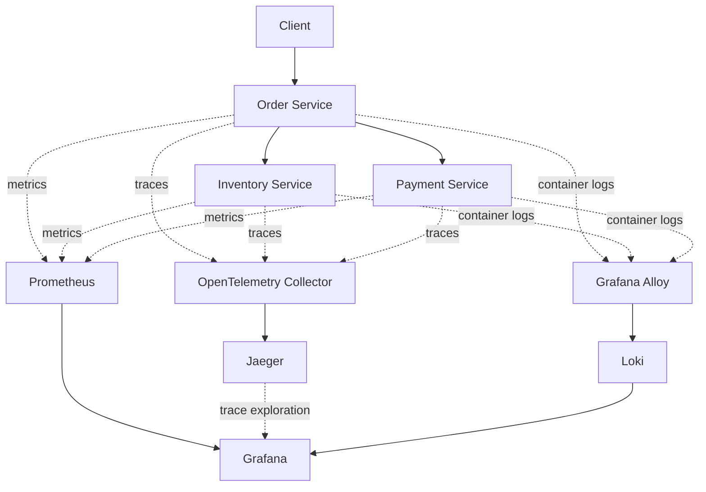

# Production Incident Investigation Platform

A microservices-based platform for exploring production failures through centralized logging, metrics, and distributed tracing. The goal is to build an evidence-driven incident investigation system that identifies likely root causes and eventually uses AI agents to assist with diagnosis.

> **Project status:** In progress — microservices and observability foundation implemented; deterministic investigation engine and AI investigation agents are planned.

## Overview

In a distributed application, a single request may pass through multiple services. When one service fails or becomes slow, identifying the source of the problem can be difficult.

This project simulates that environment and brings together observability tools to help investigate service failures, follow requests across service boundaries, and inspect application behavior.

The longer-term objective is to build an incident investigation engine that correlates logs, metrics, and traces to produce evidence-backed root-cause hypotheses.

## Current Features

- **Microservices architecture:** Separate order, payment, and inventory services built with Node.js and Express.
- **Containerization:** Run the services and observability stack using Docker Compose.
- **Failure simulation:** Trigger payment failures to observe how service errors affect requests.
- **Structured logging:** Capture application events and request-related information.
- **Centralized logging:** Collect Docker container logs with Grafana Alloy and store and query them using Loki.
- **Metrics monitoring:** Expose application metrics for collection by Prometheus.
- **Dashboards and exploration:** Use Grafana to inspect metrics and logs.
- **Distributed tracing:** Instrument Node.js services with OpenTelemetry and inspect request traces in Jaeger.
- **Request correlation:** Propagate request IDs across service calls to help investigate related events.

## Architecture



## Technology Stack

| Technology | Purpose |
|---|---|
| JavaScript, Node.js, Express | Backend microservices |
| Docker, Docker Compose | Containerization and local orchestration |
| Prometheus | Metrics collection and querying |
| Grafana | Dashboards and observability exploration |
| OpenTelemetry | Application instrumentation and trace generation |
| OpenTelemetry Collector | Trace collection and export |
| Jaeger | Distributed trace storage and visualization |
| Grafana Alloy | Log collection and forwarding |
| Loki | Centralized log storage and querying |

## Getting Started

### Prerequisites

- Git
- Node.js and npm
- Docker Engine
- Docker Compose

### Run the project

Clone the repository:

```bash
git clone <YOUR_GITHUB_REPOSITORY_URL>
cd production-incident-phase1
```

Start the services:

```bash
docker compose up -d --build
```

Inspect the containers:

```bash
docker compose ps
```

View application logs:

```bash
docker compose logs -f order-service
```

### Access the observability interfaces

When running with the current local Docker Compose configuration:

| Service | Local URL |
|---|---|
| Grafana | http://localhost:3000 |
| Prometheus | http://localhost:9090 |
| Jaeger | http://localhost:16686 |
| Loki readiness endpoint | http://localhost:3100/ready |
| Grafana Alloy UI | http://localhost:12345 |

The Grafana credentials configured in your Compose file are for local development only. Change them before any public deployment, and never commit real credentials.

> These endpoints assume the current port mappings in your local Compose configuration. They are not public deployment URLs.

## Simulating a Payment Failure

Enable payment failure simulation:

```bash
PAYMENT_FAIL=true docker compose up -d --force-recreate payment-service
```

Submit an order using the API endpoint and payload configured by your application.

Inspect the resulting behavior through:

- **Grafana:** Review the relevant metrics and collected logs.
- **Jaeger:** Inspect the failed request trace and identify the failing service span.
- **Loki:** Search for application events associated with the request ID.

Restore normal payment behavior:

```bash
PAYMENT_FAIL=false docker compose up -d --force-recreate payment-service
```

This scenario helps demonstrate how controlled failures can be investigated using different types of telemetry.

## Logs, Metrics, and Traces

The platform uses three complementary forms of telemetry:

- **Logs:** Individual application events that explain what happened.
- **Metrics:** Numerical measurements that reveal trends, error rates, and performance changes.
- **Traces:** The journey of a request across services, including operation timing and errors.

Together, these provide the evidence needed for systematic incident investigation.

## Roadmap

- [x] Build order, payment, and inventory microservices.
- [x] Run the application using Docker Compose.
- [x] Simulate payment failures.
- [x] Add application metrics and Prometheus collection.
- [x] Visualize metrics using Grafana.
- [x] Instrument services for distributed tracing.
- [x] Inspect traces using Jaeger.
- [x] Collect container logs centrally using Alloy and Loki.
- [ ] Build a deterministic incident investigation engine.
- [ ] Correlate logs, metrics, traces, and request identifiers into incident evidence.
- [ ] Generate and rank root-cause hypotheses using explicit rules.
- [ ] Build a Python/FastAPI service for AI-assisted investigation.
- [ ] Add investigation tools and specialized AI agents.
- [ ] Evaluate investigation accuracy against repeatable failure scenarios.
- [ ] Add automated tests, documentation, and a user-facing incident dashboard.

## Project Goals

The project is intended to explore:

- Backend service design and inter-service communication.
- Observability fundamentals and distributed request tracing.
- Failure simulation and debugging.
- Evidence-based root-cause analysis.
- AI-assisted incident investigation and evaluation.

## Current Limitations

- The investigation engine and AI agents are not implemented yet.
- Failure scenarios currently cover only the implemented simulations.
- The project is designed for local development and learning, not production deployment.
- Public hosting, authentication hardening, and production security configuration remain future work.

## License

Choose a license before distributing or accepting contributions. For example, you can use the MIT License by adding a `LICENSE` file if that matches your intended usage.
